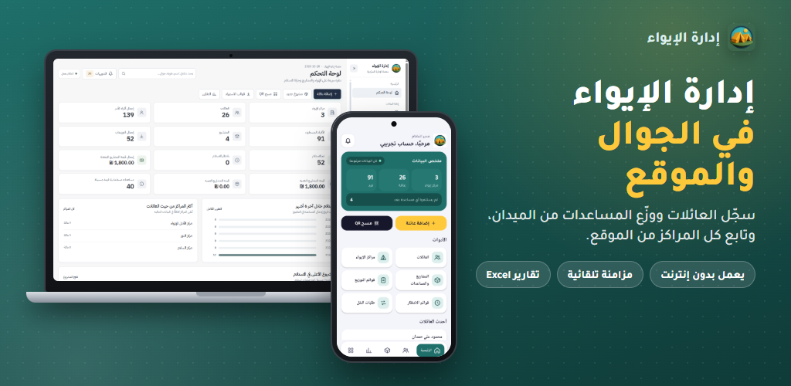
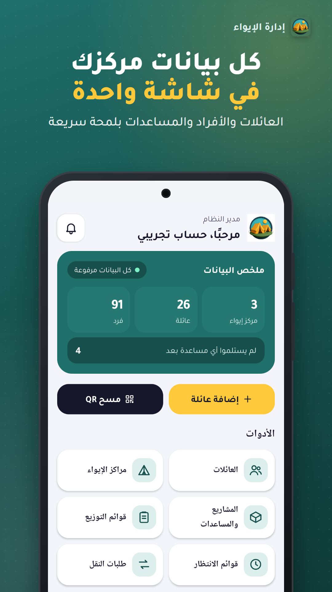
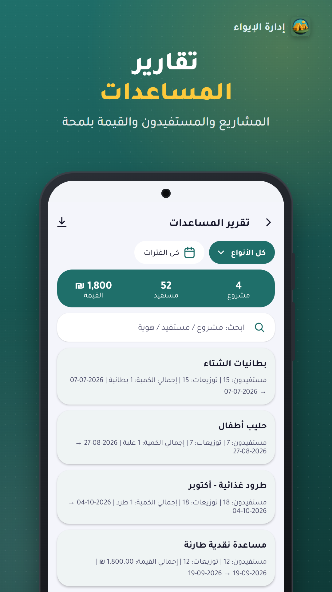
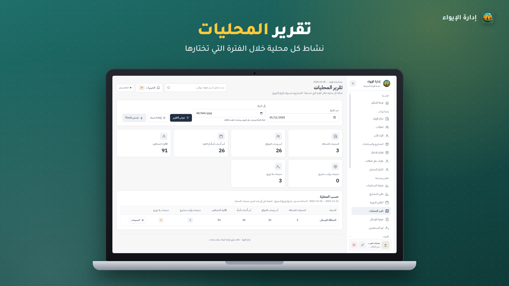

# IWAA — Shelter & Humanitarian Aid Management

**One connected experience for field teams, shelter records, and aid distribution.**

## Overview

**Iwaa** is a mobile and web system designed to organize shelter-related information and humanitarian assistance workflows. It brings family records, shelter center management, distribution tracking, and reporting into one connected experience.

The project includes a field-facing **mobile app** and an administrative **web dashboard**, with interface features for searching records, reviewing aid activity, and working with data across locations.

## Features

| Mobile & Field Workflows | Web & Administration |
|---|---|
| Shelter and household overview | Shelter center management |
| Assistance activities and lists | Families and records management |
| Aid distribution history | Regional activity summaries |
| QR and search actions shown in the mobile UI | Reporting, filters, and Excel export |
| Offline-friendly usage and synchronization, as described in the project visuals | Overview and operational monitoring |

## Screenshots

### Mobile App

  
  &nbsp;&nbsp;
  

### Web Dashboard

  

### Project Identity

  

## My Role

I worked on developing **Iwaa's mobile application and web system**, focusing on practical workflows and interfaces that support the organization of shelter and aid information.

The screenshots are provided as a product showcase. The full implementation and application configuration remain in separate, private source repositories.

## Links

- **Live website:** https://iwaa-app.com/
- **GitHub profile:** https://github.com/Ahmedxd1
- **LinkedIn:** https://www.linkedin.com/in/ahmed-al-helou/

## Code & Data Privacy

> **This is a public showcase, not an open-source code repository.** Source files, secrets, configuration, database exports, and beneficiary records are not included. Project images were selected to avoid exposing individual beneficiaries' names, identity numbers, contact details, or sensitive records.

© 2026 Ahmed H. Alhelou. Screenshots and project materials are provided for portfolio presentation.
